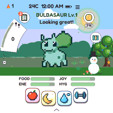
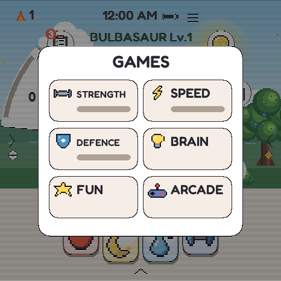
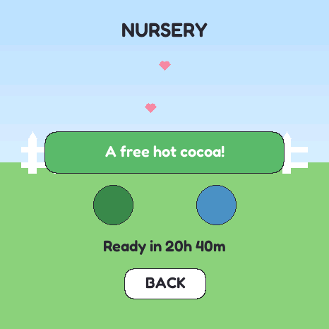
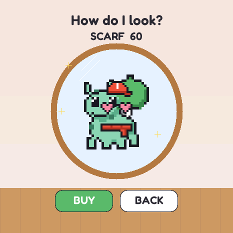
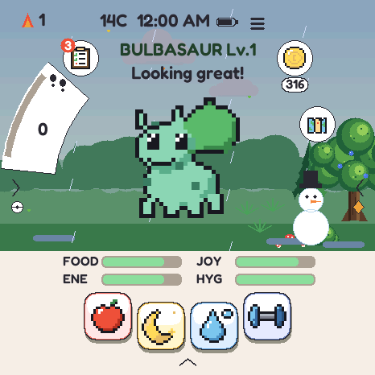
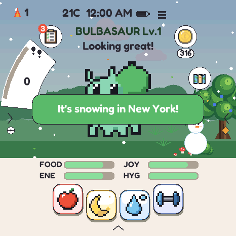
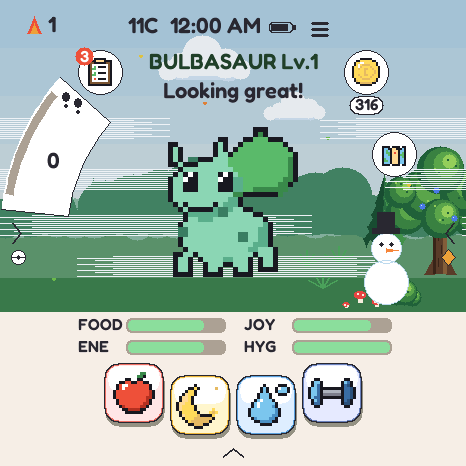
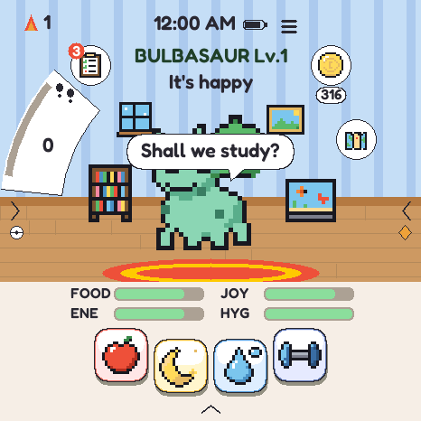
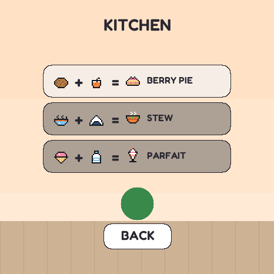
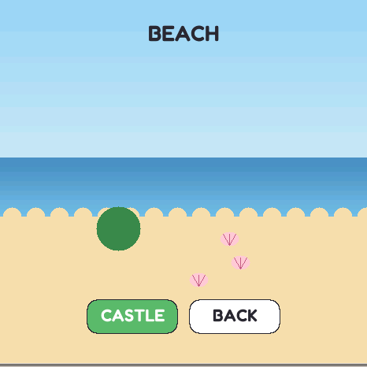

# TamaPoke -- Fun Pack

A Pokémon virtual pet in a 3D-printed Pokéball: raise it, feed it, play 28 minigames,
dress it up, visit places, and watch the real weather outside. Free and open source,
in 8 languages (Spanish, English, French, German, Italian, Portuguese, Chinese, Korean),
and installed straight from your browser.

## 🛠️ Build your own

### What you need
| Part | What for | Notes |
|---|---|---|
| **[Waveshare ESP32-S3-Touch-AMOLED-1.75](https://www.waveshare.com/wiki/ESP32-S3-Touch-AMOLED-1.75)** | The whole pet: round 466×466 screen, touch, motion sensor, clock, audio | Get the **Standard** or **-G** version. **Not "-B"** (its own case does not fit) and not the different "1.75**C**" board. **Alternative:** [this kit on Amazon](https://www.amazon.com/dp/B0F8867487), the same board sold with a speaker and a GPS antenna (the GPS is not used) |
| **microSD card** | The Pokémon sprites | Any size from 1 GB |
| **USB-C data cable** | Installing and charging | A charge-only cable will not be seen by the computer |
| **3D-printed Pokéball case** | The ball | **[Download it on MakerWorld](https://makerworld.com/es/models/2937822-tamapoke-a-pokemon-pokeball-tamagotchi)**, print profiles included (a remix of yoyothechicken's [Pokeball](https://makerworld.com/es/models/839922-pokeball)) |
| Small speaker *(optional)* | Sound and music | Plugs into the board's MX1.25 speaker connector |
| LiPo battery *(optional)* | Using it unplugged, and keeping the clock when unplugged | Check the MakerWorld page for a size that fits the case |
| 2.4 GHz Wi-Fi *(optional)* | The real time and the weather | 5 GHz-only networks will not work |

### Steps
1. **Print the case** from [MakerWorld](https://makerworld.com/es/models/2937822-tamapoke-a-pokemon-pokeball-tamagotchi).
2. **Install the firmware**: open the **[web installer](https://botero50.github.io/TamaPoke/web/)** in Chrome or Edge on a computer, plug the board in and press **Install TamaPoke**. No Arduino and no drivers.
3. **Load the sprites** onto the microSD from the same page (Kanto is enough to start), then restart.
4. **Optional: Wi-Fi.** On the same page, enter your 2.4 GHz network, so the clock sets itself and the sky shows the real weather.
5. **Assemble** the board into the ball, following the MakerWorld page.

## 🔄 Updating

On the [installer page](https://botero50.github.io/TamaPoke/web/), press **💾 Save my pet** first, then install with
**"Erase device" unticked**. Your pet, coins and everything it owns carry over. Release notes are on the
[Releases page](https://github.com/botero50/TamaPoke/releases).

## ✨ What the Fun Pack adds

Built on crenberries428's 3.14, all in 8 languages:

- **28 minigames** in six categories: Strength, Speed, Defence, Brain, Fun and Arcade.
- **Care with real moods**: food, baths, brushing teeth, medicine, colds, stomachaches, boredom, wishes, a personality.
- **Restful nights**: asleep, its needs hold, so nobody wakes up to a starving pet.
- **Coins and daily missions**, a **shop** with food, toys, 20 hats and outfits, and a **try-on mirror**.
- **A room of its own** with furniture and wallpapers, sceneries for the main screen, trophies and a photo album.
- **Places to go**: park, store, Pokémon Center, garden, school, lake, kitchen, beach, library, music hall, contest and part-time jobs, each with its own animations (the Center heals with a machine and a jingle).
- **The Nursery**: two favourites from the party or box leave an egg for the next raising.
- **Wi-Fi time and the real weather**: fog, rain, storms, settling snow, and snow from New York for places where it never snows.
- **It talks**: about 150 things to say, picked by its needs, the weather, the time of day, events and things to do.
- **Family features**: a homework timer, a math quiz, chores, a piggy bank, an alarm, a diary, and parent limits for bedtime and games.
- **Events**: birthdays, Easter, summer, Halloween, winter, weekly story quests and daily mail.
- **Arcade night**: tickets from the games, a prize counter with exclusive prizes, weekly records and bronze/silver/gold badges.

## Screens

All shots are straight off the 466x466 round panel, rendered headlessly by the
emulator (`tools/emu/tamapoke-emu --shot <name>`), so they are exactly what the
hardware draws.

### The Fun Pack

| 28 games in six categories | The Nursery | Try outfits on in the mirror |
|---|---|---|
|  |  |  |

| Real weather: rain | Snow from New York | Fog |
|---|---|---|
|  |  |  |

| A room of its own | The kitchen | The beach |
|---|---|---|
|  |  |  |

In the emulator the creature is drawn with the built-in sprite; on the ball it is the
animated one from the microSD.

### Starting out

| Pick a region | ...then its starter | Johto's three |
|---|---|---|
|  |  |  |

A new game asks which region you are playing before it asks which creature you
want. The choice sets both: you pick from that region's three starters, and it
becomes where your eggs come from afterwards (changeable later on the egg's
region pill). Existing saves never see this screen -- it only appears when the
Pokedex is empty.

### Raising one

| Your creature | Its egg | Moves it knows |
|---|---|---|
|  |  |  |

The egg carries a **region pill** — pick whether it hatches from Kanto, Johto,
Hoenn or all three. Switching keeps the rarity it was granted and remembers each
region's answer, so it cannot be flipped to farm a legendary.

**Steps.** The board's QMI8658 accelerometer counts your steps (`steps.cpp`, in
any orientation, screen on or off) and the home screen shows today's total on a
plate curved along the left edge, digits stacked down it. The arc on the rim fills
toward 10,000 and turns gold when you get there. The count resets at midnight by
the RTC. It is a counter only: it changes nothing in the game. The threshold is
tuned against synthetic gait in `steps_test`, not yet against a person walking.

### Day, dusk, night

| Day | Sunset | Night | Steps |
|---|---|---|---|
|  |  |  |  |

The sky follows the clock: a haloed sun and drifting clouds by day, a crescent
moon and twinkling stars at night. The last shot shows the step plate on the left
edge. The boot title card is `docs/screens/splash.png`.

### Battling

| The fight | Choosing a team | Winning |
|---|---|---|
|  |  |  |

Turn- and move-based, with the real type chart, ailments and STAB. Real Game Boy
battle music plays throughout.

### Five regions

| Pick a ladder | Johto's gyms | LAN battle |
|---|---|---|
|  |  |  |

Kanto, Johto, Hoenn, Sinnoh and Unova each have eight leaders, an Elite 4 and a
champion, on easy and hard. Four of the five are the games' own teams, checked
against the pokecrystal, pokeemerald and pokeplatinum disassemblies -- **0
differences across all 39 trainers**, re-checkable with
`tools/verify_rosters.py`.

**Unova is the exception and says so.** pret has no Gen 5 disassembly, so that
ladder is written from knowledge rather than from the game's own tables;
`verify_rosters.py` prints it as NOT VERIFIED rather than letting a clean run
imply otherwise. It follows Black 2 / White 2, which unlike Black/White has no
version- or starter-dependent leaders.

Sinnoh follows **Platinum**, where Fantina is the *third* gym rather than
Diamond/Pearl's fifth; the level ramp only runs 14/22/26/32/37/41/44/50 that
way. Same reasoning that makes Hoenn Emerald throughout.

### Collecting

| Pick a region | Kanto | Johto |
|---|---|---|
|  |  |  |

| Trainer card | Johto badges | The box |
|---|---|---|
|  |  |  |

### Settings

Tap the name, then **Settings**. It is five swipeable pages (Time, Volume, Brightness, Language, About); swipe
left/right to move between them, and the dots show where you are. Only the clock
needs **OK** to apply; sound, brightness and language take effect the moment you
touch them.

| Time | Volume | Brightness |
|---|---|---|
|  |  |  |
| Set the hour and minute | Sound on/off, a draggable 0–100 volume slider, and a TEST beep at the chosen level | Screen brightness 1–10; sleep and idle dimming only ever go below it |

| Language | Chinese UI | |
|---|---|---|
|  |  | The About page shows the firmware version |

## 📖 More

- **[Game manual](docs/GAME-MANUAL.md)**: every rule and number (stats, coins, eggs, evolution, battles).
- **[For developers](docs/DEVELOPERS.md)**: building from source, the emulator, sprites, serial console.
- **[Roadmap](ROADMAP.md)**: what is next.

> ### 🙏 Fork lineage
>
> TamaPoke was created by **Quique Tortosa** -- [**socquique/TamaPoke**](https://github.com/socquique/TamaPoke):
> the firmware, the sprite pipeline, the web installer, the whole thing. This repo builds on that work;
> if you like it, go **[star the original](https://github.com/socquique/TamaPoke)**.
> It also takes code from [**DylanPDao/TamaPoke**](https://github.com/DylanPDao/TamaPoke) by **Dylan Dao**.
> The 3.14 base is maintained by **Cheng Ren** -- [**crenberries428/TamaPoke**](https://github.com/crenberries428/TamaPoke).
> The Fun Pack is by **Salchi** ([botero50](https://github.com/botero50)). MIT, on the same terms as all of the above.

## Credits

Original project: [socquique/TamaPoke](https://github.com/socquique/TamaPoke) by
Quique Tortosa. Code also taken from the fork
[DylanPDao/TamaPoke](https://github.com/DylanPDao/TamaPoke) by Dylan Dao.
UI font: Fredoka (SIL OFL 1.1). Cries: pret/pokered and pret/pokecrystal.
All sprites: [PMD SpriteCollab](https://github.com/PMDCollab/SpriteCollab)
(community, CC BY-NC). Base stats: [PokéAPI](https://pokeapi.co). Pokémon is a ™ of
Nintendo / Game Freak / The Pokémon Company. Non-commercial, personal-use project.
Full list in [`CREDITS.md`](CREDITS.md).

## License

- **Source code** (firmware + tooling): **[MIT](LICENSE)** — © Cheng Ren, and
  © Quique Tortosa for the original TamaPoke.
- **Sprites & names**: © Nintendo / Game Freak / The Pokémon Company; pixel art
  from [PMD SpriteCollab](https://github.com/PMDCollab/SpriteCollab) (CC BY-NC 4.0).
  **Non-commercial use only.**
- **3D-printed case**: remix of *"Pokeball"* by **yoyothechicken**
  ([MakerWorld #839922](https://makerworld.com/es/models/839922-pokeball)),
  licensed **CC BY-NC-SA**, and shared here under the same terms.

This is an unofficial fan project, not affiliated with or endorsed by Nintendo.

